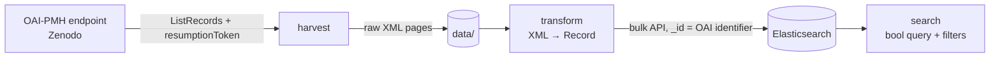

# OAI SEARCH PIPELINE
[](https://github.com/Feloche3270/oai-search-pipeline/actions/workflows/ci.yml)

`oaisearch` is a command-line tool that harvests research metadata via OAI-PMH, maps Dublin Core (DataCite in progress) to a common metadata model, and indexes it in Elasticsearch for full-text search. Search results are ranked by relevance and can be filtered by publication year, subject and language (10 results by default).
It reproduces, at small scale, the integration layer of a research data infrastructure. The demo uses a Zenodo community on water governance (181 records).

## ARCHITECTURE



| Module | Role |
|---|---|
| `harvest.py` | Fetches `ListRecords` pages, follows `resumptionToken`, retries, detects OAI errors, saves raw XML |
| `transform.py` | Parses Dublin Core XML into `Record` objects |
| `models.py` | `Record` and `SearchResult` dataclasses |
| `index.py` | Creates the index with an explicit mapping, bulk-indexes records |
| `search.py` | Builds the query, runs it, formats results |
| `cli.py` | `oaisearch harvest`, `index` and `search` commands |
| `errors.py`, `namespaces.py` | Shared exceptions and XML namespaces |

## QUICK START

**Requirements:** Python 3.12+, Docker.

```bash
git clone https://github.com/Feloche3270/oai-search-pipeline.git
cd oai-search-pipeline

# 1. Start Elasticsearch (single node, security disabled for local use)
docker compose up -d
curl http://localhost:9200            # wait ~30 s until it answers

# 2. Install
python -m venv .venv
source .venv/bin/activate             # Windows: .venv\Scripts\Activate.ps1
pip install -e ".[dev]"

# 3. Run the pipeline
oaisearch harvest --set user-waterlat-gobacit
oaisearch index --folder data/oai_dc/user-waterlat-gobacit
oaisearch search "water conflict" --from-year 2020
```

Example output:

```text
1. [13.8771] Governance of transboundary hydrographic sub basins: the Apa River basin (Brasil-Paraguay), and the Quarai River basin (Brasil-Uruguay). (in Portuguese) (2021)
Silva, Luis Paulo Batista da - por - 10.5281/zenodo.7469983
```

### Commands

| Command | Main options |
|---|---|
| `oaisearch harvest` | `--set` (required), `--endpoint` (default: Zenodo), `--prefix` (default: `oai_dc`), `--max` (default: 500), `--out` (default: `data`) |
| `oaisearch index` | `--folder` (required), `--source` (default: `zenodo`), `--index` (default: `records`), `--es-url` |
| `oaisearch search` | text (required), `--from-year`, `--subject` or `--subject-exact`, `--language`, `--all-words`, `--size` (default: 10), `--index`, `--es-url` |

Run any command with `--help` for details. Errors (unknown set, Elasticsearch not running, no records found) are printed on one line, with exit code 1.

## DATA SOURCE 
| | |
|---|---|
| Repository | Zenodo (`https://zenodo.org/oai2d`) |
| Set | `user-waterlat-gobacit` |
| Records | 181 (4 pages of 50) |

The set is the Zenodo community of the WATERLAT-GOBACIT network, which publishes research on the politics and management of water, with a strong presence in Latin America and the Caribbean. It was chosen for its domain, close to environmental and water research data, and for its size: large enough for meaningful searches, small enough to harvest in a few seconds.
Records are mainly in Spanish and English.

## MAPPING 
Every record is mapped into a common metadata model. The full mapping table is available in  [docs/mapping.md](docs/mapping.md).

### What Dublin Core loses

- **DOI:** `dc:identifier` holds several untyped identifiers, so the DOI is found by its pattern (`10.xxxx/...`). It points to this version of the record, while `dc:relation` points to the DOI of all versions.
- **Creators:** each `dc:creator` is one plain string, usually "Family, Given", but nothing guarantees it. DataCite stores family and given names in separate fields, with ORCID and affiliation.
- **Date:** Dublin Core doesn't say which date `dc:date` is (publication, creation, embargo...). Only the first valid year is kept.
- **Description:** the HTML is escaped inside the XML, so it's unescaped and its tags are removed. Bold, italic, headings, etc. are lost.  

## DESIGN CHOICES

### Harvesting

- **resumptionToken:** sent alone with the verb after page 1, because the
OAI-PMH spec makes it an exclusive argument (anything else gives `badArgument`).
Each page returns a new token, valid for about a minute on Zenodo.
- **OAI errors:** detected in the XML. The OAI-PMH spec says they come back with HTTP 200, but Zenodo sends them with a 422 status, so both are handled. `noRecordsMatch` means zero records, any other OAI error stops the harvest.
- **Retries:** only on 429, 5xx and network errors, which are temporary, with exponential backoff and the `Retry-After` header when a 429 provides it. Other errors (404, 400...) fail immediately.
- **Raw XML first:** pages are saved as raw XML in `data/<prefix>/<set>/`, then transformed by the `index` command. The transform can be re-run without harvesting again, and nothing slow happens between two pages while the token is valid.

### Common model

One `Record` dataclass, independent of the source format. The `source` field is
set by the caller, not read from the XML: the XML doesn't say which repository
it came from, and this field lets one index hold records from several repositories.

### Index mapping

- **Explicit mapping**: every field has a declared type. Without it, Elasticsearch guesses each type from the first document (dynamic mapping), and a type **can't be changed later** without reindexing. The index is always created before bulk indexing, so it never falls back to a guessed mapping. 
- **text vs keyword**: `text` fields are analyzed into terms and used for scored full-text search. `keyword` fields keep the exact value and are used for filters and sorting. `title`, `creators` and `subjects` are multi-fields (both text and keyword). For example, creators can be searched by last name and filtered on an exact name. 
- **Single node**:  `number_of_replicas: 0`. A replica must live on a different node from its primary, so on one node the index would stay yellow. A production cluster with several nodes would keep replicas.
- **Standard analyzer**: the records mix Spanish and English. A language specific analyzer would apply one language's rules (such as English stemming) to all of them. `standard` only splits and lowercases. The trade-off: without stemming, "risk" doesn't match "risks".

### Bulk + idempotency

- **Bulk API:** indexing 181 records one by one would mean 181 HTTP requests. The bulk API sends them in chunks (500 documents by default, so a single request here), which means far fewer network round-trips.
- **Not atomic:** each document gets its own result, so some can fail while others succeed. Successful documents stay indexed, and failures raise an error listing the failed documents.
- **Generator:** actions are produced one at a time as bulk consumes them, instead of building a full list in memory. The records themselves are still loaded into a list first.
- **Idempotent `_id`:** the OAI identifier is the document id, so re-indexing replaces existing documents instead of duplicating them. If the pipeline crashes or a document fails, it can simply be run again.

### Search

- **`bool` query:** the free text goes in `must`, because it's what BM25 scores. The year, subject and language go in `filter`: they're yes/no conditions, so they aren't scored, and their results are cached for repeated searches.
- **`multi_match` with boosts:** on `title^4`, `subjects^3`, `creators` and `description`. Title and subjects are short, chosen words, while the description is long and noisy. With the default type `best_fields`, a document is scored on its best-matching field.
- **`minimum_should_match` or `and`:** by default, 67% of the words must match, rounded down (2 words -> 1 required, 3 words -> 2, 4 words -> 2). With `--all-words`, every word must match, in any order.
- **`--subject` vs `--subject-exact`:** `--subject` is a tolerant `match` filter. `--subject-exact` is an exact `term` on `subjects.keyword` (case-sensitive). They're mutually exclusive.
- **Output:** 10 results by default, 2 lines each: rank, score, title, year. Then creators, language and DOI.

### Query DSL

Queries are written as plain Python dicts: the dict is exactly the JSON Elasticsearch receives, so the structure is visible at a glance and matches the official documentation. In a larger codebase, I'd consider the client's `elasticsearch.dsl` module for composable, reusable queries.

## TESTING

```bash
pytest                                              # all tests
pytest --cov=oaisearch --cov-report=term-missing    # with coverage
ruff check . && ruff format --check . && mypy src   # lint, format, types
```

- **No network, no Elasticsearch:** tests use saved XML fixtures (`tests/fixtures/`), `httpx.MockTransport` to simulate the OAI-PMH server (token paging, retries on 429/503/network errors, no retry on 404, OAI errors, invalid XML), and `monkeypatch` + `capsys` for the CLI.
- **Testable by design:** `harvest` receives its HTTP client as a parameter, so tests can pass a client whose transport is a fake server.
- **Coverage:** 90% in total; `harvest.py` and `transform.py` at 100%. The functions that call a live Elasticsearch were tested manually against the Docker setup.
- **CI:** GitHub Actions runs ruff, mypy and pytest on Python 3.12, 3.13 and 3.14 for every pull request. The version matrix caught a `%` in an argparse help string that only Python 3.14 rejects at startup.

## ELASTICSEARCH VS SOLR

Elasticsearch was chosen because its JSON Query DSL makes the query structure explicit and its official Python client is well documented, which let me focus on the pipeline and on search concepts within a one-week scope. I haven't used Solr yet. Both are built on Apache Lucene, so the concepts used here (inverted index, analyzers, BM25 scoring, text vs exact fields) are the same. As far as I understand Solr's `edismax` query parser, this project's search would translate as:

| This project (Elasticsearch) | Solr equivalent |
|---|---|
| `multi_match` with field boosts | `qf=title^4 subjects^3 creators description` |
| `minimum_should_match: 67%` | `mm=67%` |
| `bool.filter` (not scored, cached) | `fq=` filter queries |
| Explicit mapping | Field types in the schema |

## LIMITS AND FUTURE WORK

### Limits 

- Zenodo doesn't report deleted records (`deletedRecord: no`). Incremental harvesting would keep stale records. A periodic full re-harvest is needed.
- `--max` is rounded up to whole pages (50 records per page on Zenodo), e.g `--max 60` harvests 100 records (2 full pages).
- Records without a year are excluded when `--from-year` is used.
- One `standard` analyzer for all languages. No stemming, so "risk" doesn't match "risks". 
- Security is disabled for local development. 
- Only Dublin Core is mapped

### Future work

- DataCite mapping (structured creators with ORCID, typed DOI, geoLocations)
- Incremental harvesting with `from=`
- Per-language analyzers using the `language` field
- Stream records from disk to Elasticsearch (`load_records` as a generator)
- Port the indexing and search steps to Solr to compare both engines on the same data.

## LICENSE

MIT, see [LICENSE](LICENSE). The test fixtures contain metadata records harvested
from Zenodo (WATERLAT-GOBACIT community).